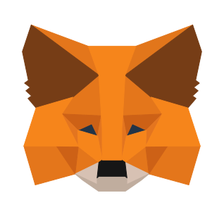

# Hi 👋, I'm Alvito Wahyu

### Programmer, graphic designer, crypto trader, and airdrop hunter from Kediri.

- 🌱 I'm currently studying Informatics Engineering at **Universitas Negeri Surabaya**
- 💻 I build small web apps and Python programs
- 🎨 I do graphic design and video editing
- 📈 I trade crypto and hunt airdrops
- 📫 How to reach me: **alvitowahyu8@gmail.com**

### Connect with me:

---

### 💻 Programmer

  
  
  
  
  
  
  
  

### 🎨 Graphic Design

  
  
  
  
  
  
  

### 📈 Crypto Trader

  
  
  
  
  
  
  

### GitHub stats:

### Projects:

- [dashboard-order-makanan-warung-limo](https://github.com/vitowahyu/dashboard-order-makanan-warung-limo): dashboard untuk memesan makanan di warung UMKM (JavaScript)
- [python-balap-mobil](https://github.com/vitowahyu/python-balap-mobil): program balap mobil sederhana (Python)
- [PROJECT-UNDANGAN-UTS](https://github.com/vitowahyu/PROJECT-UNDANGAN-UTS): tugas UTS, halaman undangan (HTML, CSS)
- [selamat-ulang-tahun-nadya](https://github.com/vitowahyu/selamat-ulang-tahun-nadya): halaman ucapan ulang tahun (HTML)
